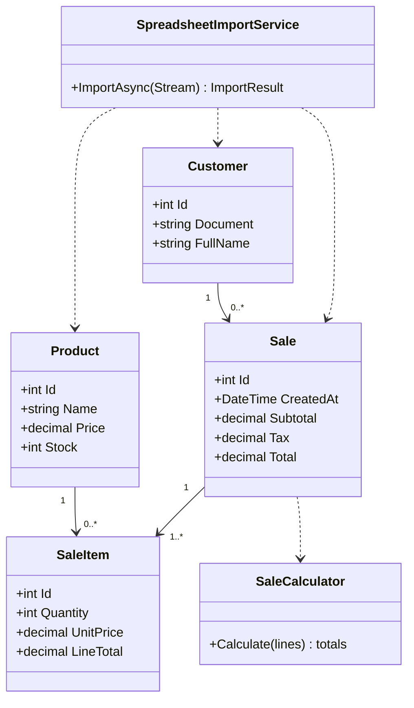

# Firmeza

Aplicación web ASP.NET Core MVC para gestionar productos, clientes e inventario, registrar ventas y generar comprobantes. La aplicación usa .NET 10, PostgreSQL, Entity Framework Core e Identity.

## Funcionalidades

- CRUD de productos y clientes con navegación adaptable a móvil.
- API REST ASP.NET Core para productos, clientes y ventas, protegida con JWT y roles `Admin`/`Cliente`, con documentación Swagger y DTOs de AutoMapper.
- Importación masiva de libros `.xlsx` con encabezados mezclados o desordenados. Reconoce encabezados en español e inglés, normaliza acentos y mayúsculas, actualiza productos/clientes por nombre/documento y registra inconsistencias por fila.
- Si una fila contiene producto, precio, cliente con documento y cantidad, importa también una venta y descuenta existencias. La cantidad debe ser un entero positivo y el stock debe alcanzar.
- Exportación de productos, clientes y ventas a Excel y PDF.
- Registro de ventas, validación de inventario, cálculo de IVA del 19% y recibo PDF descargable. Los comprobantes se escriben en `wwwroot/recibos`.
- Migraciones de Entity Framework aplicadas automáticamente al arrancar la aplicación.
- Pruebas unitarias xUnit del cálculo de venta, perfiles AutoMapper y emisión de JWT.

### Encabezados aceptados en Excel

El importador revisa la primera fila de cada hoja. Algunos ejemplos: `Producto`/`Product`, `Nombre producto`, `Cliente`/`Customer`, `Nombre cliente`, `Nombre`, `Documento`/`Document`/`Cédula`, `Precio`/`Price`, `Descripción`, `Stock`, `Cantidad`/`Quantity`, `Correo`/`Email`, `Teléfono`/`Phone` y `Fecha`/`Date`. Los encabezados pueden estar en cualquier orden. Para una venta en una fila mixta, separa las columnas `Producto` y `Cliente` (nombres de entidad) y agrega precio, documento y cantidad; si se usa un único encabezado `Nombre`, el importador lo interpreta como producto cuando la fila incluye precio y como cliente cuando incluye correo/documento sin precio.

La importación admite `.xlsx` de hasta 10 MB. Filas con errores se omiten y se muestran en el resultado; el botón de descarga genera el log CSV. Las actualizaciones de filas válidas se guardan individualmente, de modo que un error en otra fila no revierte las anteriores.

## Requisitos

- .NET SDK 10.0
- PostgreSQL 15 o posterior para ejecución local (Docker Compose incluye PostgreSQL)
- Docker Desktop con Docker Compose para el despliegue local en contenedores

## Ejecución local

1. Configura PostgreSQL y define la cadena de conexión mediante una variable de entorno (no guardes contraseñas en el repositorio):

   ```powershell
   $env:ConnectionStrings__DefaultConnection = "Host=localhost;Port=5432;Database=FirmezaDB;Username=postgres;Password=TU_CLAVE"
   ```

2. Restaura y ejecuta la aplicación:

   ```powershell
   dotnet restore Firmeza.sln
   dotnet run --project Firmeza.Web
   ```

3. Abre la URL local que indique `dotnet run`. Las migraciones se aplican al iniciar.

Para habilitar Excel, configura una licencia EPPlus en el entorno. Por ejemplo, para uso comercial:

```powershell
$env:EPPlus__License = "Commercial:TU_CLAVE_DE_LICENCIA"
```

Para uso personal/no comercial permitido por la licencia de EPPlus:

```powershell
$env:EPPlus__License = "NonCommercialPersonal:Tu Nombre"
```

EPPlus 8 requiere configuración de licencia. Revisa si la licencia no comercial aplica al uso previsto; una organización comercial requiere licencia comercial. La licencia de QuestPDF Community también tiene criterios propios: confirma que el proyecto califica antes de distribuirlo comercialmente.

## API REST

El proyecto independiente `Firmeza.Api` reutiliza `ApplicationDbContext`, las migraciones y las entidades del módulo MVC, por lo que ambos proyectos consultan la misma base PostgreSQL. El archivo `Firmeza.Api/appsettings.json` contiene host, puerto, base de datos y usuario de desarrollo; la contraseña y la clave JWT se suministran con User Secrets o variables de entorno.

| Método y ruta | Acceso | Descripción |
| --- | --- | --- |
| `GET /api/health` | Público | Verifica conectividad y consulta las tablas de productos, clientes y ventas. |
| `POST /api/auth/register` | Público | Crea cuenta Identity y perfil `Cliente`, envía bienvenida si SMTP está configurado y entrega token. |
| `POST /api/auth/login` | Público | Valida credenciales y emite JWT con roles. |
| `GET /api/products` | JWT | Lista, busca (`search`), filtra por precio y existencias. |
| `GET /api/products/{id}` | JWT | Consulta producto. |
| `POST /api/products`, `PUT /api/products/{id}`, `DELETE /api/products/{id}` | Admin | CRUD de productos. |
| `GET /api/customers/me` | Cliente | Lee el perfil asociado al correo autenticado. |
| `GET /api/customers`, `GET /api/customers/{id}` | Admin | Lista/busca y consulta clientes. |
| `POST /api/customers`, `PUT /api/customers/{id}`, `DELETE /api/customers/{id}` | Admin | CRUD de clientes. |
| `GET /api/sales`, `GET /api/sales/{id}` | Admin o Cliente | El rol Cliente solo accede a sus propias ventas. |
| `POST /api/sales` | Admin o Cliente | Registra venta, descuenta inventario y envía confirmación de compra. |
| `PUT`, `DELETE /api/sales/{id}` | Admin | Actualiza o elimina venta y ajusta inventario. |

El arranque crea los roles `Admin` y `Cliente`. El registro público solo asigna `Cliente`; para crear o promover un administrador, configura `BootstrapAdmin__Email` y `BootstrapAdmin__Password` en secretos de desarrollo o despliegue. No hay endpoint público para asignar privilegios.

### Ejecutar la API

Configura secretos locales (el valor de `Jwt:Key` debe tener al menos 32 bytes):

```powershell
dotnet user-secrets init --project Firmeza.Api
dotnet user-secrets set "ConnectionStrings:DefaultConnection" "Host=localhost;Port=5432;Database=FirmezaDB;Username=postgres;Password=TU_CLAVE" --project Firmeza.Api
dotnet user-secrets set "Jwt:Key" "CAMBIA_POR_UN_SECRETO_ALEATORIO_DE_64_CARACTERES" --project Firmeza.Api
dotnet user-secrets set "BootstrapAdmin:Email" "admin@ejemplo.com" --project Firmeza.Api
dotnet user-secrets set "BootstrapAdmin:Password" "CAMBIA_POR_UNA_CLAVE_SEGURA" --project Firmeza.Api
dotnet run --project Firmeza.Api
```

Swagger UI: `https://localhost:7001/swagger` (o la URL que muestre `dotnet run`). Autoriza llamadas pegando el token obtenido en `/api/auth/login`. En `Cors:AllowedOrigins` agrega el origen exacto del cliente Blazor, por ejemplo `https://localhost:7042`; el valor vacío no permite orígenes cruzados.

### Correo Gmail

`IAppEmailSender` separa la lógica de notificación del transporte SMTP; `SmtpEmailSender` es la implementación actual. Configura `Email__Host=smtp.gmail.com`, `Email__Port=587`, `Email__EnableSsl=true`, `Email__User`, `Email__Password` y `Email__FromAddress` mediante secretos. Usa una contraseña de aplicación de Gmail; Google indica que estas requieren la verificación en dos pasos y publica el puerto 587 con TLS/STARTTLS para SMTP saliente ([contraseñas de aplicación](https://support.google.com/accounts/answer/185833), [parámetros SMTP](https://support.google.com/mail/answer/7104828)). Si SMTP no está configurado, registro y ventas se completan y la respuesta indica que el correo no fue enviado.

AutoMapper puede configurarse con `AUTOMAPPER_LICENSE_KEY` según la licencia aplicable a la organización. Swagger incluye el esquema Bearer para JWT.

## Ejecución con Docker Compose

Define una contraseña para PostgreSQL y, si usarás importación/exportación Excel, tu configuración EPPlus:

```powershell
$env:POSTGRES_PASSWORD = "una-clave-segura"
$env:EPPLUS_LICENSE = "Commercial:TU_CLAVE_DE_LICENCIA"
docker compose up --build -d
```

La web estará disponible en `http://localhost:8080` y la API en `http://localhost:8081` (`/swagger`). Para Compose, también define `JWT_KEY` (secreto aleatorio de 32 bytes o más). Opcionalmente configura `BLAZOR_ORIGIN`, `ADMIN_EMAIL`, `ADMIN_PASSWORD` y las variables `SMTP_USER`, `SMTP_PASSWORD`, `SMTP_FROM_ADDRESS`. Compose espera a que PostgreSQL esté saludable antes de iniciar las aplicaciones. Los datos de PostgreSQL y los PDF se guardan en volúmenes Docker `pgdata` y `recibos`. Para detener los contenedores: `docker compose down`. Para respaldar la base:

```powershell
docker compose exec firmeza-db pg_dump -U postgres FirmezaDB > respaldo.sql
```

Guarda las claves en un gestor de secretos en cualquier despliegue compartido. Las migraciones se ejecutan al arrancar; al desplegar varias réplicas, aplica las migraciones una sola vez antes de escalar la aplicación.

## Pruebas

```powershell
dotnet test Firmeza.sln
```

## Modelo de datos


## Diagrama de clases



## Estructura

- `Firmeza.Web/Controllers`: endpoints MVC de productos, clientes, ventas, importación y exportación.
- `Firmeza.Web/Models`: entidades, validaciones y cálculo de venta.
- `Firmeza.Web/Services`: importación de Excel y configuración de licencia EPPlus.
- `Firmeza.Api`: API JWT, CRUD REST, DTOs/mapeos AutoMapper, servicio de correo y Swagger.
- `Firmeza.Web/Data` y `Migrations`: EF Core y esquema PostgreSQL.
- `Firmeza.Tests`: pruebas unitarias xUnit.
