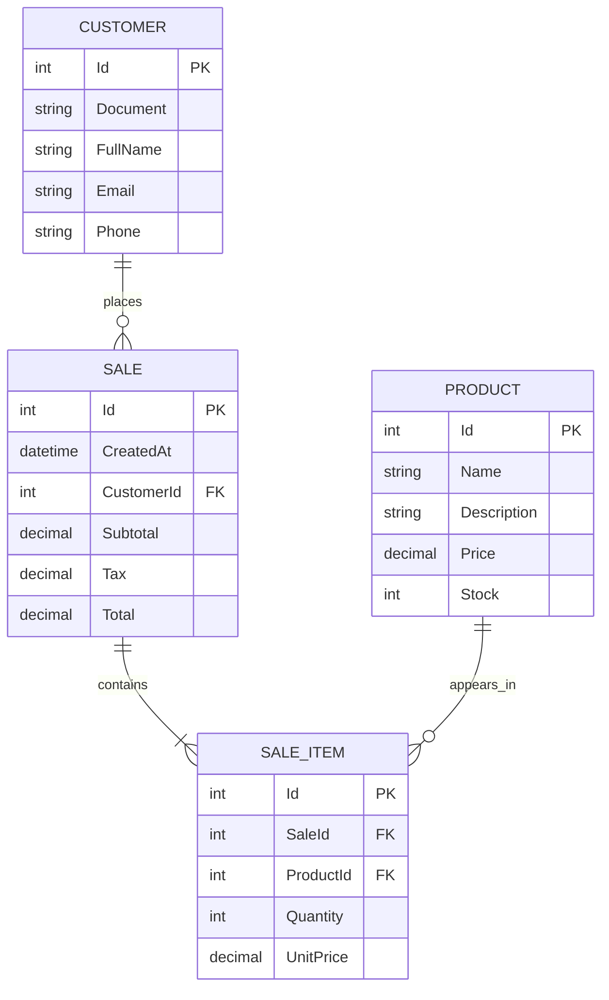
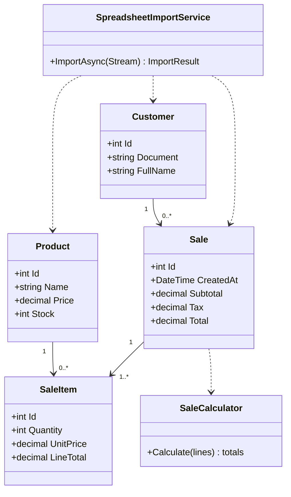

# Firmeza

Firmeza is an ASP.NET Core web application for managing products, customers, and inventory, recording sales, and generating receipts. It uses .NET 10, PostgreSQL, Entity Framework Core, and ASP.NET Core Identity.

## Features

- Product and customer CRUD with a responsive navigation layout.
- ASP.NET Core REST API for products, customers, and sales, protected by JWT and the `Admin`/`Cliente` roles, with Swagger documentation and AutoMapper DTOs.
- Bulk import of `.xlsx` workbooks with mixed or unordered headers. The importer recognizes Spanish and English headers, normalizes accents and capitalization, updates products/customers by name or document, and records row-level inconsistencies.
- If a row contains a product, price, customer document, and quantity, it also imports a sale and reduces inventory. Quantity must be a positive integer and sufficient stock must be available.
- Product, customer, and sales export to Excel and PDF.
- Sales registration, inventory validation, 19% VAT calculation, and downloadable PDF receipts. Receipts are written to `wwwroot/recibos`.
- Entity Framework migrations are applied automatically when the application starts.
- xUnit tests for sale calculations, AutoMapper profiles, and JWT issuance.

### Supported Excel headers

The importer checks the first row of each worksheet. Examples include `Producto`/`Product`, `Nombre producto`, `Cliente`/`Customer`, `Nombre cliente`, `Nombre`, `Documento`/`Document`/`Cédula`, `Precio`/`Price`, `Descripción`, `Stock`, `Cantidad`/`Quantity`, `Correo`/`Email`, `Teléfono`/`Phone`, and `Fecha`/`Date`. Headers can appear in any order. For a sale in a mixed row, use separate `Producto` and `Cliente` columns and include price, document, and quantity. If a row uses a single `Nombre` header, the importer treats it as a product when the row includes a price, and as a customer when it includes an email or document but no price.

The importer accepts `.xlsx` files up to 10 MB. Rows with errors are skipped and listed in the result; the download button creates a CSV error log. Valid rows are saved individually, so an error in one row does not roll back other rows.

## Requirements

- .NET SDK 10.0
- PostgreSQL 15 or later for local runs (Docker Compose includes PostgreSQL)
- Docker Desktop with Docker Compose for local container deployment

## Run locally

1. Configure PostgreSQL and set the connection string through an environment variable. Do not store passwords in the repository:

   ```powershell
   $env:ConnectionStrings__DefaultConnection = "Host=localhost;Port=5432;Database=FirmezaDB;Username=postgres;Password=YOUR_PASSWORD"
   ```

2. Restore and run the application:

   ```powershell
   dotnet restore Firmeza.sln
   dotnet run --project Firmeza.Web
   ```

3. Open the local URL printed by `dotnet run`. Migrations are applied at startup.

To enable Excel features, configure an EPPlus license in the environment. For example, for commercial use:

```powershell
$env:EPPlus__License = "Commercial:YOUR_LICENSE_KEY"
```

For personal/non-commercial use allowed by the EPPlus license:

```powershell
$env:EPPlus__License = "NonCommercialPersonal:Your Name"
```

EPPlus 8 requires license configuration. Check whether the non-commercial license applies to your intended use; commercial organizations need a commercial license. QuestPDF Community also has its own eligibility criteria, so confirm that the project qualifies before commercial distribution.

## REST API

The standalone `Firmeza.Api` project reuses `ApplicationDbContext`, migrations, and entities from the MVC module, so both projects use the same PostgreSQL database. `Firmeza.Api/appsettings.json` contains the development host, port, database, and username; provide the password and JWT key through User Secrets or environment variables.

| Method and route | Access | Description |
| --- | --- | --- |
| `GET /api/health` | Public | Checks connectivity and queries the products, customers, and sales tables. |
| `POST /api/auth/register` | Public | Creates an Identity account and `Cliente` profile, sends a welcome email if SMTP is configured, and returns a token. |
| `POST /api/auth/login` | Public | Validates credentials and issues a JWT with roles. |
| `GET /api/products` | JWT | Lists products; supports search and price/stock filters. |
| `GET /api/products/{id}` | JWT | Gets a product. |
| `POST /api/products`, `PUT /api/products/{id}`, `DELETE /api/products/{id}` | Admin | Product CRUD. |
| `GET /api/customers/me` | Cliente | Gets the profile associated with the authenticated email. |
| `GET /api/customers`, `GET /api/customers/{id}` | Admin | Lists, searches, and gets customers. |
| `POST /api/customers`, `PUT /api/customers/{id}`, `DELETE /api/customers/{id}` | Admin | Customer CRUD. |
| `GET /api/sales`, `GET /api/sales/{id}` | Admin or Cliente | The `Cliente` role can access only its own sales. |
| `POST /api/sales` | Admin or Cliente | Records a sale, reduces inventory, and sends a purchase confirmation. |
| `PUT`, `DELETE /api/sales/{id}` | Admin | Updates or deletes a sale and adjusts inventory. |

Startup creates the `Admin` and `Cliente` roles. Public registration assigns only `Cliente`. To create or promote an administrator, configure `BootstrapAdmin__Email` and `BootstrapAdmin__Password` in development secrets or deployment settings. There is no public endpoint for assigning privileges.

### Run the API

Configure local secrets (`Jwt:Key` must be at least 32 bytes):

```powershell
dotnet user-secrets init --project Firmeza.Api
dotnet user-secrets set "ConnectionStrings:DefaultConnection" "Host=localhost;Port=5432;Database=FirmezaDB;Username=postgres;Password=YOUR_PASSWORD" --project Firmeza.Api
dotnet user-secrets set "Jwt:Key" "REPLACE_WITH_A_RANDOM_SECRET_OF_AT_LEAST_32_BYTES" --project Firmeza.Api
dotnet user-secrets set "BootstrapAdmin:Email" "admin@example.com" --project Firmeza.Api
dotnet user-secrets set "BootstrapAdmin:Password" "REPLACE_WITH_A_STRONG_PASSWORD" --project Firmeza.Api
dotnet run --project Firmeza.Api
```

Swagger UI: `https://localhost:7001/swagger` (or the URL printed by `dotnet run`). Authorize requests by pasting the token returned by `/api/auth/login`. Add the exact React client origin to `Cors:AllowedOrigins`, for example `https://localhost:7042`; an empty value does not allow cross-origin requests.

### Gmail email

`IAppEmailSender` separates notification logic from the SMTP transport; `SmtpEmailSender` is the current implementation. Configure `Email__Host=smtp.gmail.com`, `Email__Port=587`, `Email__EnableSsl=true`, `Email__User`, `Email__Password`, and `Email__FromAddress` through secrets. Use a Gmail app password; Google requires two-step verification for app passwords and documents port 587 with TLS/STARTTLS for outgoing SMTP ([app passwords](https://support.google.com/accounts/answer/185833), [SMTP settings](https://support.google.com/mail/answer/7104828)). If SMTP is not configured, registration and sales still complete, and the response reports that the email was not sent.

AutoMapper can be configured with `AUTOMAPPER_LICENSE_KEY` according to the license that applies to the organization. Swagger includes the Bearer scheme for JWT.

## Run with Docker Compose

On Windows, install and start Docker Desktop, copy the full project folder to the new computer, and double-click `Iniciar-Firmeza.bat`. On Linux, install Docker Engine and Docker Compose, copy the project folder, and run `./iniciar-firmeza.sh` from a terminal. If needed, grant execute permission once with `chmod +x iniciar-firmeza.sh`.

Both scripts create `.env` from `.env.example` if it does not exist and run `docker compose up --build -d`. Compose builds the services, runs `Firmeza.Tests` first, and starts PostgreSQL, the API, the Razor web app, and the React portal only after the tests pass. If a test fails, the `tests` service exits with an error and Compose does not start the database or applications. The scripts then print local addresses and open the portal if the operating system has a browser-opening command. The first build may take several minutes and needs internet access to download images and packages.

You can also start the system from a terminal in the project folder:

```powershell
docker compose up --build -d
```

To stop services without deleting persistent data, run `docker compose down`. Do not use `docker compose down -v` unless you also want to delete the database and receipt volumes.

The portal is available at `http://localhost:5173`, the Razor web app at `http://localhost:8080`, and API Swagger at `http://localhost:8081/swagger`. PostgreSQL data and PDF receipts are stored in the Docker volumes `pgdata` and `recibos`. The test service uses `Firmeza.Tests/Dockerfile`; the web app, API, and client each have independent production Dockerfiles. To back up the database:

```powershell
docker compose exec db pg_dump -U postgres FirmezaDB > backup.sql
```

The `.env` file is optional for a basic startup. Copy and edit `.env.example` to configure `SMTP_USER`, `SMTP_PASSWORD`, and `SMTP_FROM_ADDRESS` for email; `ADMIN_EMAIL` and `ADMIN_PASSWORD` for the initial administrator; and `EPPLUS_LICENSE` for Excel features. In a real deployment, replace `JWT_KEY` with a private random key of at least 32 bytes. Do not share `.env`.

Compose creates a new database and applies migrations automatically; copying the project to another computer does not transfer data from the previous Docker volume. To preserve products, customers, and sales, create a `pg_dump` backup on the original computer and restore it on the new one. Ports `5432`, `5173`, `8080`, and `8081` must be available. Migrations run at startup; when deploying multiple replicas, apply migrations once before scaling the application.

## Tests

```powershell
dotnet test Firmeza.sln
```

## Data model



## Class diagram



## Project structure

- `Firmeza.Web/Controllers`: MVC endpoints for products, customers, sales, import, and export.
- `Firmeza.Web/Models`: entities, validation, and sale calculations.
- `Firmeza.Web/Services`: Excel import and EPPlus license configuration.
- `Firmeza.Api`: JWT API, REST CRUD, DTOs and AutoMapper mappings, email service, and Swagger.
- `Firmeza.Web/Data` and `Migrations`: EF Core context and PostgreSQL schema.
- `Firmeza.Tests`: xUnit tests.
- `Firmeza.Portal`: React SPA for customer purchases, JWT authentication, cart, and order history.

## React customer portal

The portal runs independently of the Razor application. Start PostgreSQL and the API on port `8081`, then run:

```powershell
cd Firmeza.Portal
npm install
Copy-Item .env.example .env
npm run dev
```

Open `http://localhost:5173`. `VITE_API_BASE_URL` changes the API base URL (default: `http://localhost:8081/api`). During development, the API allows the `http://localhost:5173` origin from `appsettings.Development.json`; in Docker, `BLAZOR_ORIGIN` controls the allowed origin.

The portal uses customer registration and login, profile, available product catalog, purchase creation and history, and receipt download. The JWT is stored in `sessionStorage`, sent as a Bearer token, and removed on logout, expiration, or a `401` response. Run portal checks with `npm test` and create a production bundle with `npm run build`.

After each purchase, the API generates a PDF receipt, returns it from `GET /api/sales/{id}/receipt`, and attaches it to the confirmation email. To send real emails, configure `SMTP_USER`, `SMTP_PASSWORD` (a Gmail app password), and `SMTP_FROM_ADDRESS` in Docker Compose; for a local run, use the `Email__User`, `Email__Password`, and `Email__FromAddress` variables. If SMTP is not configured, the purchase is recorded and the PDF remains available for download, but the UI should not report that an email was sent.
