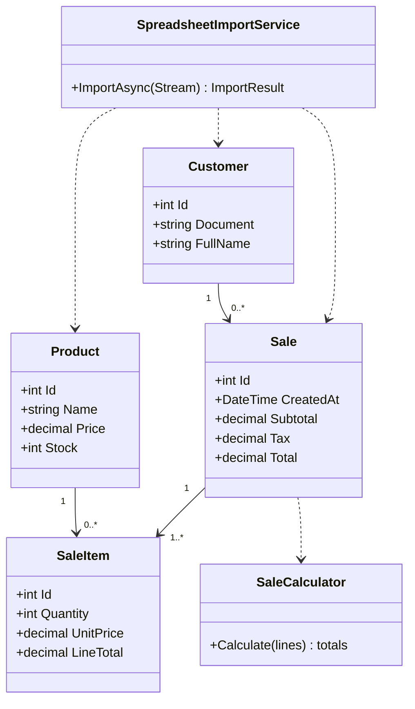

# Firmeza

Aplicación web ASP.NET Core MVC para gestionar productos, clientes e inventario, registrar ventas y generar comprobantes. La aplicación usa .NET 10, PostgreSQL, Entity Framework Core e Identity.

## Funcionalidades

- CRUD de productos y clientes con navegación adaptable a móvil.
- Importación masiva de libros `.xlsx` con encabezados mezclados o desordenados. Reconoce encabezados en español e inglés, normaliza acentos y mayúsculas, actualiza productos/clientes por nombre/documento y registra inconsistencias por fila.
- Si una fila contiene producto, precio, cliente con documento y cantidad, importa también una venta y descuenta existencias. La cantidad debe ser un entero positivo y el stock debe alcanzar.
- Exportación de productos, clientes y ventas a Excel y PDF.
- Registro de ventas, validación de inventario, cálculo de IVA del 19% y recibo PDF descargable. Los comprobantes se escriben en `wwwroot/recibos`.
- Migraciones de Entity Framework aplicadas automáticamente al arrancar la aplicación.
- Prueba unitaria del cálculo del subtotal, IVA y total.

### Encabezados aceptados en Excel

El importador revisa la primera fila de cada hoja. Algunos ejemplos: `Producto`/`Product`, `Nombre producto`, `Cliente`/`Customer`, `Nombre cliente`, `Nombre`, `Documento`/`Document`/`Cédula`, `Precio`/`Price`, `Descripción`, `Stock`, `Cantidad`/`Quantity`, `Correo`/`Email`, `Teléfono`/`Phone` y `Fecha`/`Date`. Los encabezados pueden estar en cualquier orden. Para una venta en una fila mixta, separa las columnas `Producto` y `Cliente` (nombres de entidad) y agrega precio, documento y cantidad; si se usa un único encabezado `Nombre`, el importador lo interpreta como producto cuando la fila incluye precio y como cliente cuando incluye correo/documento sin precio.

La importación admite `.xlsx` de hasta 10 MB. Filas con errores se omiten y se muestran en el resultado; el botón de descarga genera el log CSV. Las actualizaciones de filas válidas se guardan individualmente, de modo que un error en otra fila no revierte las anteriores.

## Requisitos

- .NET SDK 10.0
- PostgreSQL 15 o posterior para ejecución local (Docker Compose incluye PostgreSQL)
- Docker Desktop con Docker Compose para el despliegue local en contenedores

## Ejecución local

1. Configura PostgreSQL y define la cadena de conexión mediante una variable de entorno (no guardes contraseñas en el repositorio):

   ```powershell
   $env:ConnectionStrings__DefaultConnection = "Host=localhost;Port=5432;Database=FirmezaDB;Username=postgres;Password=TU_CLAVE"
   ```

2. Restaura y ejecuta la aplicación:

   ```powershell
   dotnet restore Firmeza.sln
   dotnet run --project Firmeza.Web
   ```

3. Abre la URL local que indique `dotnet run`. Las migraciones se aplican al iniciar.

Para habilitar Excel, configura una licencia EPPlus en el entorno. Por ejemplo, para uso comercial:

```powershell
$env:EPPlus__License = "Commercial:TU_CLAVE_DE_LICENCIA"
```

Para uso personal/no comercial permitido por la licencia de EPPlus:

```powershell
$env:EPPlus__License = "NonCommercialPersonal:Tu Nombre"
```

EPPlus 8 requiere configuración de licencia. Revisa si la licencia no comercial aplica al uso previsto; una organización comercial requiere licencia comercial. La licencia de QuestPDF Community también tiene criterios propios: confirma que el proyecto califica antes de distribuirlo comercialmente.

## Ejecución con Docker Compose

Define una contraseña para PostgreSQL y, si usarás importación/exportación Excel, tu configuración EPPlus:

```powershell
$env:POSTGRES_PASSWORD = "una-clave-segura"
$env:EPPLUS_LICENSE = "Commercial:TU_CLAVE_DE_LICENCIA"
docker compose up --build -d
```

La aplicación estará disponible en `http://localhost:8080`. Compose espera a que PostgreSQL esté saludable antes de iniciar la web. Los datos de PostgreSQL y los PDF se guardan en volúmenes Docker `pgdata` y `recibos`. Para detener los contenedores: `docker compose down`. Para respaldar la base:

```powershell
docker compose exec firmeza-db pg_dump -U postgres FirmezaDB > respaldo.sql
```

Guarda las claves en un gestor de secretos en cualquier despliegue compartido. Las migraciones se ejecutan al arrancar; al desplegar varias réplicas, aplica las migraciones una sola vez antes de escalar la aplicación.

## Pruebas

```powershell
dotnet test Firmeza.sln
```

## Modelo de datos


## Diagrama de clases



## Estructura

- `Firmeza.Web/Controllers`: endpoints MVC de productos, clientes, ventas, importación y exportación.
- `Firmeza.Web/Models`: entidades, validaciones y cálculo de venta.
- `Firmeza.Web/Services`: importación de Excel y configuración de licencia EPPlus.
- `Firmeza.Web/Data` y `Migrations`: EF Core y esquema PostgreSQL.
- `Firmeza.Tests`: pruebas unitarias xUnit.
